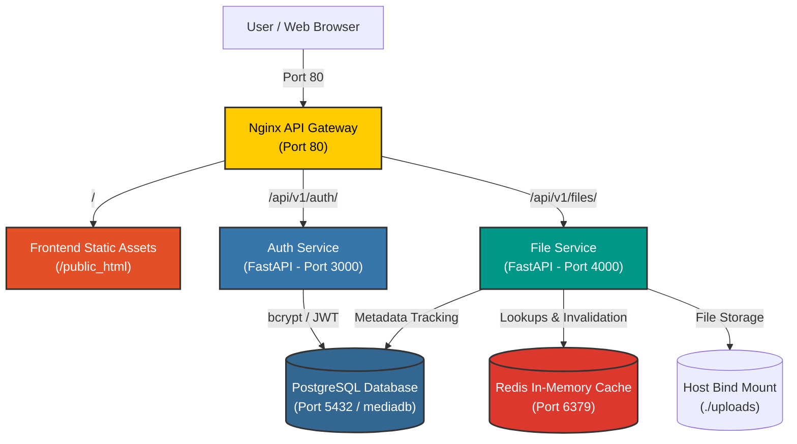

# Cloud Media & Auth Microservice Platform

A containerized full-stack microservices web platform built to demonstrate modern backend engineering, JWT authentication, persistent data storage, Redis caching, reverse proxy gateway routing, and an interactive web frontend dashboard.

---

### Core Stack


---

## 🚀 Key Architecture & Features

- **Frontend Dashboard:** A Google Drive-style Web UI served on Port 80 featuring authentication, dynamic user avatar badges, theme switching, image grid/list layouts, search filtering, and live data-source detection (`Cache` vs. `Database`).
- **API Gateway (Nginx):** Public entry point on Port 80 routing static frontend traffic (`/`), Auth service requests (`/api/v1/auth/`), and File service requests (`/api/v1/files/`).
- **Auth Microservice:** FastAPI microservice handling bcrypt password hashing, account creation, and PyJWT token generation with persistent session isolation.
- **File Upload Microservice:** Protected by JWT Bearer security; handles image uploads, local host bind-mount storage (`./uploads`), static image rendering, and automatic DB metadata tracking.
- **Metadata Persistence:** PostgreSQL 15 relational database storing user accounts (`users`) and file upload metadata (`file_metadata`) with automatic startup retry connection handling.
- **In-Memory Caching (Redis):** Accelerates metadata lookups (`GET /my-files`) with a 60-second TTL to deliver sub-millisecond responses and reduce database query load, featuring automatic cache invalidation upon new uploads (`POST /upload`).

---

### Architecture & Traffic Flow



---

## 📂 Project Structure

```text
cloud-media-project/
├── docker-compose.yml        # Docker Compose multi-container orchestration
├── README.md                 # Project documentation
├── frontend/
│   └── index.html            # Interactive web dashboard frontend
├── gateway/
│   └── nginx.conf            # Nginx API Gateway reverse proxy configuration
├── services/
│   ├── auth-service/         # User registration & JWT authentication service
│   │   ├── Dockerfile
│   │   ├── main.py
│   │   └── requirements.txt
│   └── file-service/         # Media upload, static file serving, & metadata tracking
│       ├── Dockerfile
│       ├── main.py
│       └── requirements.txt
└── uploads/                  # Host directory bind-mounted for image persistence
```

---

## ⚙️ Getting Started Locally

### Prerequisites

- [Docker Desktop](https://www.docker.com/) installed and running.
- [Git](https://git-scm.com/) installed on your machine.

### Installation & Running

1. **Clone the repository:**
   ```bash
   git clone https://github.com/AsherFerdinand/docker-fastapi-microservice-stack.git
   cd docker-fastapi-microservice-stack
   ```

2. **Spin up the multi-container stack using Docker Compose:**
   ```bash
   docker compose up --build -d
   ```

3. **Verify running containers:**
   ```bash
   docker ps
   ```

---

## 🔗 Endpoints & Web Access

| Service / Interface | Local URL | Description |
| :--- | :--- | :--- |
| **Web Dashboard** | [http://localhost/](http://localhost/) | Main interactive web page for authentication and media management |
| **Auth API Docs** | [http://localhost/api/v1/auth/docs](http://localhost/api/v1/auth/docs) | OpenAPI/Swagger interface for Auth endpoints |
| **File Service Docs** | [http://localhost/api/v1/files/docs](http://localhost/api/v1/files/docs) | OpenAPI/Swagger interface for File processing endpoints |

### Key API Endpoints

- **`POST /api/v1/auth/register`**: Registers a new user with bcrypt-hashed credentials.
- **`POST /api/v1/auth/login`**: Authenticates user and generates a Bearer JWT access token.
- **`POST /api/v1/files/upload`**: Uploads an image file (JWT required), saves file to disk, persists metadata to PostgreSQL, and invalidates user cache.
- **`GET /api/v1/files/my-files`**: Fetches user uploaded files metadata list (JWT required). Queries Redis cache first (<1ms TTL: 60s); falls back to PostgreSQL on cache miss.
- **`GET /api/v1/files/static/{filename}`**: Serves stored images statically for frontend thumbnail rendering.

---

## 🧪 Database & Cache Verification

To inspect stored user records and file metadata directly inside the PostgreSQL container:

```bash
docker exec -it local_postgres psql -U admin -d mediadb -c "SELECT * FROM users;"
docker exec -it local_postgres psql -U admin -d mediadb -c "SELECT * FROM file_metadata;"
```

To verify cached keys inside the Redis container:

```bash
docker exec -it local_redis redis-cli KEYS "*"
```

---

## 🛠️ Project Roadmap & Status

- [x] **Phase 1: Core Foundation & Auth Service**
  - Containerized PostgreSQL and Redis using Docker Compose.
  - Developed Python FastAPI Auth Service with bcrypt password hashing and JWT issuance.
  - Verified persistent database storage and initial OpenAPI Swagger integration.

- [x] **Phase 2: Gateway Routing, Media Storage & Caching**
  - Integrated Nginx API Gateway on port `80` to proxy auth and file traffic dynamically.
  - Built File Upload Microservice handling image files and host bind-mount storage.
  - Added PostgreSQL metadata tracking (`file_metadata`) and Redis caching with automatic invalidation.
  - Implemented Google Drive-style web frontend on Port 80 with thumbnail rendering.
  - Implemented resilient PostgreSQL startup retry connection loops for zero cold-start failures.

- [ ] **Phase 3: Interactive & 3D Spatial UI Enhancements**
  - **Skeuomorphic 3D Desk Workspace:** Interactive desk view where document cards lie flat on a table, tilting in 3D space on mouse hover.
  - **Physics Drag-and-Drop Trash Bin:** Interactive trash bin in the bottom-right corner triggering a paper crumble animation on drop and executing `DELETE /api/v1/files/{id}`.
  - **Web HMI & Spatial Canvas:** Integration of Three.js / WebGL canvas effects for immersive spatial file inspection.

- [ ] **Phase 4: Cloud Infrastructure & Advanced Microservices**
  - **MinIO S3 Object Storage:** Offload local disk storage to S3-compatible MinIO containers using presigned upload URLs.
  - **File Actions & Management:** Add backend file deletion, download endpoints, and a trash bin recovery queue.
  - **AI Vector Search:** Integrate PostgreSQL `pgvector` for natural language semantic image and document content queries.
  - **GitOps, CI/CD & Cloud Deployment:** Set up GitHub Actions CI/CD workflows and deploy the containerized stack to a cloud Linux VPS.
